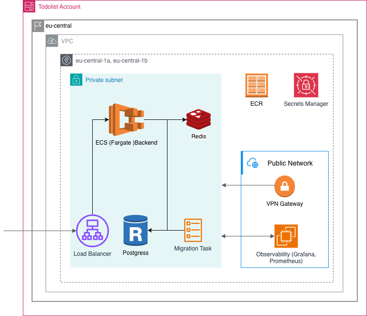

  

AI made writing backend code easy - running it in production is still hard.

**Prod Forge** is an open-source reference that shows how to build and operate a production-ready backend: CI/CD,
infrastructure, observability, migrations, and rollback.

Built around a simple Todo API, but designed as a real-world production system.

---

## Project structure

| Repository                                         | Description                                     |
|----------------------------------------------------|-------------------------------------------------|
| [Frontend](https://github.com/prod-forge/frontend) | React Web and React Mobile apps + Design System |
| [Backend](https://github.com/prod-forge/backend)   | NestJS API - the main guide                     |
| [Infrastructure](https://github.com/prod-forge/terraform) | Terraform on AWS                                |

## Stack

  

| Layer          | Tools                                                              |
| -------------- | ------------------------------------------------------------------ |
| web-client     | React · Vite · Redux Toolkit · Tailwind CSS · NX                  |
| Deploy         | AWS S3 · CloudFront · ECR · ECS                                   |
| Backend        | NestJS · Prisma · PostgreSQL · Redis · Docker                     |
| Infrastructure | AWS · RDS · ElastiCache                                          |
| Observability  | Prometheus · Grafana · Loki · Promtail                            |
| Quality        | ESLint · Prettier · Husky · Commitlint · CI/CD                    |

# Table of contents

- [1. Development Setup](docs/development-setup.md)
  - [IDE Setup (WebStorm)](docs/development-setup.md#ide-setup-webstorm)
    - [Install Terraform plugin](docs/development-setup.md#install-terraform-plugin)
    - [Configure Terraform formatting watcher](docs/development-setup.md#configure-terraform-formatting-watcher)
  - [Preparing AWS Access](docs/development-setup.md#preparing-aws-access)
    - [Setting up IAM Identity Center](docs/development-setup.md#setting-up-iam-identity-center)
    - [Configure Local AWS Profile](docs/development-setup.md#configure-local-aws-profile)
  - [Verify AWS Connection](docs/development-setup.md#verify-aws-connection)
  - [Global Terraform State](docs/development-setup.md#global-terraform-state)
  - [State Locking](docs/development-setup.md#state-locking)
  - [Bootstrap Infrastructure](docs/development-setup.md#bootstrap-infrastructure)

<!-- -->

- [2. Environments](docs/environments.md)
  - [Environment Strategy](docs/environments.md#environment-strategy)
    - [Development Environment (dev)](docs/environments.md#development-environment-dev)
    - [Production Environment (prod)](docs/environments.md#production-environment-prod)
    - [Why Not Use Pre-Production?](docs/environments.md#why-not-use-pre-production)
  - [Key Principle](docs/environments.md#key-principle)
  - [Layout in the Code](docs/environments.md#layout-in-the-code)
    - [Differences Between dev and prod](docs/environments.md#differences-between-dev-and-prod)
    - [One AWS Account or Two](docs/environments.md#one-aws-account-or-two)
  - [Creating dev](docs/environments.md#creating-dev)
  - [Cost per Environment](docs/environments.md#cost-per-environment)

<!-- -->

- [3. Workflow](docs/workflow.md)
  - [Amazon ECR](docs/workflow.md#amazon-ecr)
    - [The "Chicken-and-Egg" Dilemma](docs/workflow.md#the-chicken-and-egg-dilemma)
    - [Initial Application Image](docs/workflow.md#initial-application-image)
      - [Required Endpoints](docs/workflow.md#required-endpoints)
  - [AWS Secrets Manager](docs/workflow.md#aws-secrets-manager)
  - [GitHub Integration for CI/CD](docs/workflow.md#github-integration-for-cicd)
    - [Approaches](docs/workflow.md#approaches)
      - [1. Dedicated AWS User](docs/workflow.md#1-dedicated-aws-user)
      - [2. OpenID Connect (OIDC) - Recommended](docs/workflow.md#2-openid-connect-oidc---recommended)
    - [Terraform Setup](docs/workflow.md#terraform-setup)
    - [Deploy workflow variables](docs/workflow.md#deploy-workflow-variables)
    - [Why OIDC is Recommended](docs/workflow.md#why-oidc-is-recommended)
  - [ECS Cluster](docs/workflow.md#ecs-cluster)
    - [Networking](docs/workflow.md#networking)
  - [Application Load Balancer (ALB)](docs/workflow.md#application-load-balancer-alb)
  - [ECS Service](docs/workflow.md#ecs-service)
    - [IAM](docs/workflow.md#iam)
  - [Task Definition](docs/workflow.md#task-definition)
  - [One-Run ECS Tasks](docs/workflow.md#one-run-ecs-tasks)

<!-- -->

- [4. Frontend Deployment](docs/frontend.md)
  - [Architecture](docs/frontend.md#architecture)
  - [Custom Domain](docs/frontend.md#custom-domain)
  - [WAF and Access Logs](docs/frontend.md#waf-and-access-logs)
  - [Security Headers](docs/frontend.md#security-headers)
  - [SPA Routing](docs/frontend.md#spa-routing)
  - [Cache Strategy](docs/frontend.md#cache-strategy)
  - [Deployment](docs/frontend.md#deployment)
  - [Rollback](docs/frontend.md#rollback)
  - [Terraform Setup](docs/frontend.md#terraform-setup)
  - [GitHub Actions Integration](docs/frontend.md#github-actions-integration)
  - [Advantages](docs/frontend.md#advantages)
  - [Limitations](docs/frontend.md#limitations)

<!-- -->

- [5. Observability](docs/observability.md)
  - [Deployment Model](docs/observability.md#deployment-model)
  - [Why EC2?](docs/observability.md#why-ec2)
  - [Observability Data Flow](docs/observability.md#observability-data-flow)
  - [Advantages of This Approach](docs/observability.md#advantages-of-this-approach)
    - [Simplicity](docs/observability.md#simplicity)
    - [Cost Efficiency](docs/observability.md#cost-efficiency)
    - [Full Control](docs/observability.md#full-control)
    - [Infrastructure Independence](docs/observability.md#infrastructure-independence)
  - [Limitations](docs/observability.md#limitations)
    - [Single Point of Failure](docs/observability.md#single-point-of-failure)
    - [Scaling Limitations](docs/observability.md#scaling-limitations)
    - [Operational Maintenance](docs/observability.md#operational-maintenance)
  - [When to Use Managed Observability](docs/observability.md#when-to-use-managed-observability)

<!-- -->

- [6. Debugging](docs/debugging.md)
  - [ECS / Fargate Debugging](docs/debugging.md#ecs--fargate-debugging)
    - [Inspect ECS Tasks](docs/debugging.md#inspect-ecs-tasks)
    - [Execute Commands Inside Container](docs/debugging.md#execute-commands-inside-container)
  - [RDS, Redis Debugging (OpenVPN)](docs/debugging.md#rds-redis-debugging-openvpn)
    - [Install OpenVPN](docs/debugging.md#install-openvpn)
    - [Generate Certificates](docs/debugging.md#generate-certificates)
    - [Generate Client Certificate](docs/debugging.md#generate-client-certificate)
    - [Generate VPN Client Configuration](docs/debugging.md#generate-vpn-client-configuration)
    - [Verify VPN Connection](docs/debugging.md#verify-vpn-connection)
    - [Connect to RDS or Redis](docs/debugging.md#connect-to-rds-or-redis)
  - [Monitoring host access (SSM Session Manager)](docs/debugging.md#monitoring-host-access-ssm-session-manager)
    - [Debugging bootstrap.sh](docs/debugging.md#debugging-bootstrapsh)

<!-- -->

- [7. Troubleshooting](docs/troubleshooting.md)
  - [EC2/ECS + RDS Network Routing Connection](docs/troubleshooting.md#ec2ecs--rds-network-routing-connection)

<!-- -->

- [8. Destroying the Infrastructure](docs/destroy.md)
  - [Why Order Matters](docs/destroy.md#why-order-matters)
  - [Step 1 — Destroy Infrastructure](docs/destroy.md#step-1--destroy-infrastructure)
  - [Step 2 — Unlock the Bootstrap](docs/destroy.md#step-2--unlock-the-bootstrap)
  - [Step 3 — Delete the IAM User](docs/destroy.md#step-3--delete-the-iam-user)

<!-- -->

- [9. CI for Infrastructure](docs/ci.md)
  - [Jobs](docs/ci.md#jobs)
  - [Reproducibility](docs/ci.md#reproducibility)
  - [Running locally](docs/ci.md#running-locally)
  - [Tests](docs/ci.md#tests)
  - [Why there is no terraform plan in CI yet](docs/ci.md#why-there-is-no-terraform-plan-in-ci-yet)
  - [Baseline](docs/ci.md#baseline)

<!-- -->

- [10. Backup and Disaster Recovery](docs/backup-and-dr.md)
  - [Protection in place](docs/backup-and-dr.md#protection-in-place)
  - [Objectives](docs/backup-and-dr.md#objectives)
  - [Restore procedure](docs/backup-and-dr.md#restore-procedure)
  - [Quarterly restore drill](docs/backup-and-dr.md#quarterly-restore-drill)
  - [Not covered](docs/backup-and-dr.md#not-covered)

<!-- -->

- [11. Scaling](docs/scaling.md)
  - [Capacity model](docs/scaling.md#capacity-model)
  - [Scaling policies](docs/scaling.md#scaling-policies)
  - [Deployments and shutdown](docs/scaling.md#deployments-and-shutdown)
  - [How to load-test the policies](docs/scaling.md#how-to-load-test-the-policies)
  - [Fargate Spot trade-off](docs/scaling.md#fargate-spot-trade-off)

<!-- -->

- [12. Security](docs/security.md)
  - [TLS everywhere](docs/security.md#tls-everywhere)
    - [Without a domain (insecure fallback)](docs/security.md#without-a-domain-insecure-fallback)
  - [WAF](docs/security.md#waf)
  - [Response headers](docs/security.md#response-headers)
  - [Load balancer hardening](docs/security.md#load-balancer-hardening)
  - [Access logs](docs/security.md#access-logs)
  - [Security groups](docs/security.md#security-groups)
  - [IAM](docs/security.md#iam)
  - [Account security baseline](docs/security.md#account-security-baseline)
  - [Known gaps](docs/security.md#known-gaps)

<!-- -->

- [13. Cost](docs/cost.md)
  - [Monthly Estimate](docs/cost.md#monthly-estimate)
  - [Main Levers](docs/cost.md#main-levers)
  - [Budget](docs/cost.md#budget)

<!-- -->

- [14. Migration to the Environments Layout](docs/migration-to-environments.md)
  - [What Stays the Same](docs/migration-to-environments.md#what-stays-the-same)
  - [Moved Addresses](docs/migration-to-environments.md#moved-addresses)
  - [What Is Replaced](docs/migration-to-environments.md#what-is-replaced)
  - [Rollout](docs/migration-to-environments.md#rollout)
  - [Expected Downtime](docs/migration-to-environments.md#expected-downtime)
  - [Rollback](docs/migration-to-environments.md#rollback)

<!-- -->

- [15. Blue/Green Deployment (design note, not implemented)](docs/blue-green.md)
  - [Why](docs/blue-green.md#why)
  - [What changes in the service](docs/blue-green.md#what-changes-in-the-service)
  - [What changes in the CD workflow](docs/blue-green.md#what-changes-in-the-cd-workflow)
  - [Trade-offs](docs/blue-green.md#trade-offs)

# Conclusion

Building software is not just about writing code.

Most engineers learn the craft of coding early in their careers. But the gap between writing working code and running a
reliable system in production is wide - and rarely documented in one place.

This project is an attempt to close that gap.

Not by providing a magic template you can clone and ship. But by walking through every decision that happens before,
during, and after the code is written.

The stack used here - NestJS, Postgres, Redis, Terraform, AWS - is not the point. These are just tools. The principles
behind them apply to almost any production backend, regardless of language or cloud provider.

What matters is the thinking:

- Why does repository structure affect team velocity?
- Why does commit discipline make releases safer?
- Why does observability matter before something breaks?
- Why does a rollback plan need to exist before you need it?

These are not advanced topics. They are basic requirements for any system that real users depend on.
The goal of Prod Forge is to make these practices visible, understandable, and reusable.

## What comes next

This project is actively evolving.
Planned additions include:

- Mobile App repository with the same level of production treatment
- Blue/Green deployments for ECS (design note in [docs/blue-green.md](docs/blue-green.md))
- Kubernetes-based infrastructure as an alternative to ECS

The frontend repository already exists and is deployed by this Terraform (see [Frontend Deployment](docs/frontend.md)).

If there is something missing that you would find valuable, open an issue or start a discussion.

## A final thought

The best time to set up these practices is at the beginning of a project.

The second best time is now.

A system without observability is a system you cannot debug under pressure. A team without a defined workflow is a team
that slows down as it grows. A deployment without a rollback plan is a deployment that will eventually cause an incident
with no recovery path.

None of these things are difficult to set up. They are just easy to skip.
This project exists as a reminder not to skip them.

# Contributing

We welcome any kind of contribution, please read the guidelines:

[CONTRIBUTING](CONTRIBUTING.md)

# The MIT License

[LICENSE](LICENSE.md)
