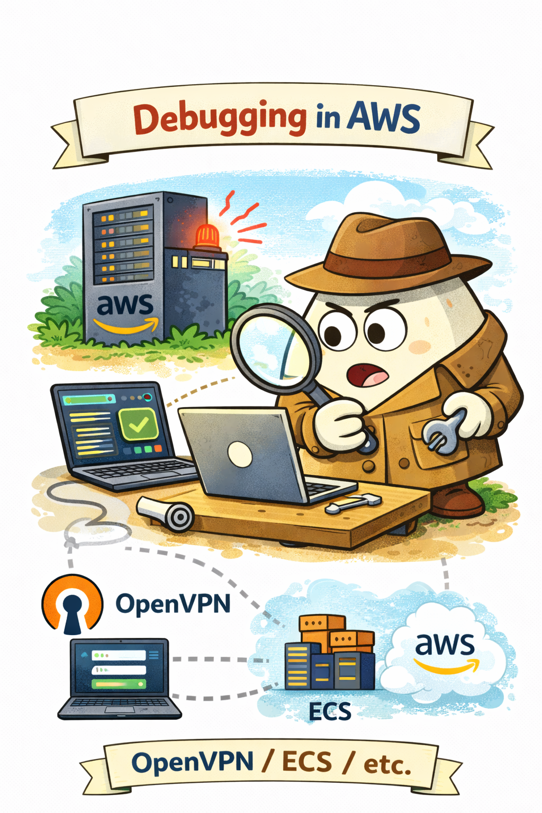
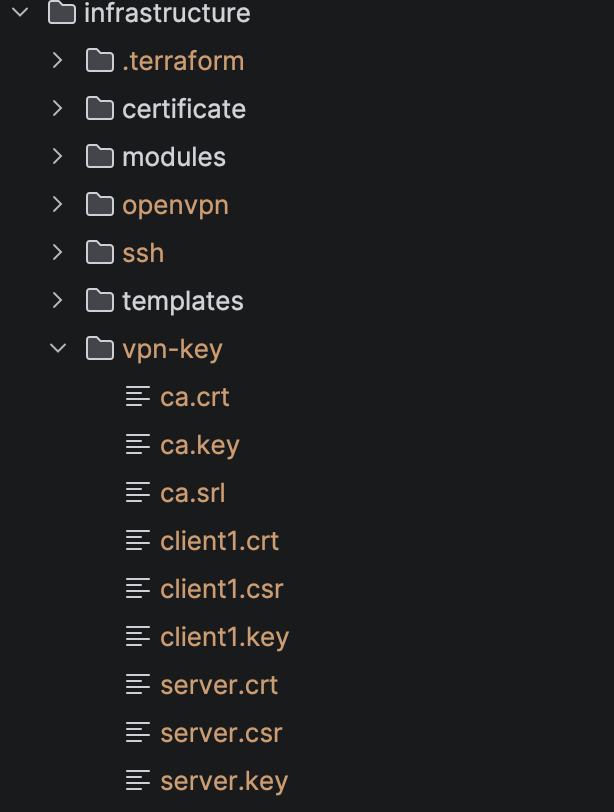
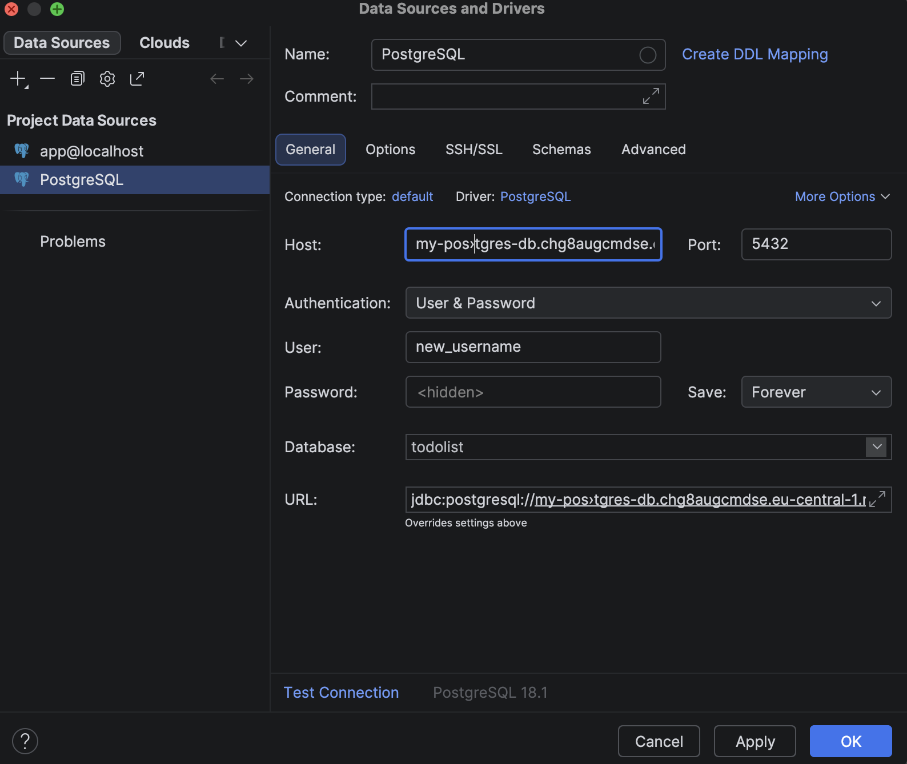

# Debugging and Troubleshooting

<p align="center">
  
</p>

Debugging is one of the most critical aspects of operating production infrastructure.

When something goes wrong in production, engineers must be able to quickly diagnose the problem and identify the root
cause.

This project demonstrates several common debugging practices used when working with AWS infrastructure and containerized
applications.

## ECS / Fargate Debugging

For debugging running containers in AWS ECS Fargate, the session-manager-plugin must be installed.

[Installation guide](https://docs.aws.amazon.com/systems-manager/latest/userguide/install-plugin-macos-overview.html)

### Inspect ECS Tasks

Check the current task status:

```shell
aws ecs describe-tasks \
  --cluster <CLUSTER_NAME> \
  --tasks <TASK_ARN> \
  --query "tasks[0].containers[*].[name,lastStatus,healthStatus,exitCode]"
```

Expected output:

```shell
[
  [
    "some_name",
    "RUNNING",
    "UNKNOWN",
    null
  ]
]
```

### Execute Commands Inside Container

To open an interactive shell inside the container:

```shell
aws ecs execute-command \
  --cluster <CLUSTER_NAME> \
  --task <TASK_ARN> \
  --container <TASK_CONTAINER> \
  --interactive \
  --command "/bin/sh" \
  --region eu-central-1
```

## RDS, Redis Debugging (OpenVPN)

To debug the RDS database and Redis, we need to get into the private network.

To access these resources securely, a VPN connection can be established.

### Install OpenVPN

Example for macOS:

```shell
brew install openvpn
```

### Generate Certificates

The Terraform roots read the VPN certificates from `infrastructure/vpn-key/` (variable `vpn_key_dir`, default `../../vpn-key`). The folder is git-ignored. Create it and copy the OpenSSL config next to the keys:

```shell
mkdir -p infrastructure/vpn-key
cp infrastructure/certificate/openssl.cnf infrastructure/vpn-key/
cd infrastructure/vpn-key
```

Run the following commands inside `infrastructure/vpn-key`:

```shell
openssl genrsa -out ca.key 2048
openssl req -x509 -new -nodes -key ca.key -sha256 -days 3650 -out ca.crt -subj "/CN=todo"
openssl genrsa -out server.key 2048
```

Create server certificate:

```shell
openssl req -new -key server.key -out server.csr -config openssl.cnf
```

Sign the certificate:

```shell
openssl x509 -req \
  -in server.csr \
  -CA ca.crt \
  -CAkey ca.key \
  -CAcreateserial \
  -out server.crt \
  -days 825 \
  -sha256 \
  -extfile openssl.cnf \
  -extensions v3_ext
```

As a result, you should have this list of files in the **vpn-key** folder:

<p align="center">
  
</p>

Verify:

```shell
openssl x509 -in server.crt -text -noout
```

Expected output:

```shell
DNS:vpn.internal.local
```

The VPN is optional (`enable_client_vpn`, off in dev). Be aware that the server and CA private keys are Terraform inputs, so they are stored in the environment's state file in plain text. Mitigation: keep the state bucket private, encrypted and limited to the deploy roles (as bootstrap sets it up), use a CA created only for this VPN, rotate the certificates when someone leaves the team, and set `enable_client_vpn = false` when the VPN is not needed.

### Generate Client Certificate

```shell
openssl genrsa -out client1.key 2048
openssl req -new -key client1.key -out client1.csr -subj "/CN=client1"
```

Sign client certificate:

```shell
openssl x509 -req \
  -in client1.csr \
  -CA ca.crt \
  -CAkey ca.key \
  -CAcreateserial \
  -out client1.crt \
  -days 825 \
  -sha256
```

### Generate VPN Client Configuration

After you apply VPN Terraform configuration you can generate VPN Client:

```shell
aws ec2 export-client-vpn-client-configuration \
    --client-vpn-endpoint-id <VPN_ENDPOINT> \
    --output text > client.ovpn
```

Add the client certificate to the configuration file (after </ca> block):

```shell
<cert>
(client1.crt)
</cert>

<key>
(client1.key)
</key>
```

#### Verify VPN Connection

1. Connect to VPN
2. Check network interfaces:

```shell
ifconfig
```

Expected output:

```shell
utun4: flags=8051<UP,POINTOPOINT,RUNNING,MULTICAST>
inet 10.200.0.34 --> 10.200.0.33 netmask 0xffffffe0
```

Then resolve RDS through the internal DNS:

```shell
nslookup my-postgres-db.chg8augcmdse.eu-central-1.rds.amazonaws.com 10.0.0.2
```

Expected output:

```shell
Name: my-postgres-db.chg8augcmdse.eu-central-1.rds.amazonaws.com
Address: 10.0.2.27
```

### Connect to RDS or Redis

As a result, we can connect to RDS or Redis through VPN:

<p align="center">
  
</p>

## Monitoring host access (SSM Session Manager)

The monitoring instance has no SSH key and no port 22. Connect through SSM Session Manager, which needs the AWS CLI with the [Session Manager plugin](https://docs.aws.amazon.com/systems-manager/latest/userguide/session-manager-working-with-install-plugin.html) and IAM permission for `ssm:StartSession`.

Find the instance and open a shell:

```shell
aws ec2 describe-instances --filters Name=tag:Name,Values=Monitoring Name=instance-state-name,Values=running \
  --query 'Reservations[].Instances[].InstanceId' --output text
aws ssm start-session --target <instance-id>
```

Reach Grafana without opening port 3000:

```shell
aws ssm start-session --target <instance-id> \
  --document-name AWS-StartPortForwardingSession \
  --parameters '{"portNumber":["3000"],"localPortNumber":["3000"]}'
```

If the session does not start, check in EC2 -> Instances that the instance is running and in the SSM console (Fleet Manager) that it is listed as managed. The instance needs outbound HTTPS and the `AmazonSSMManagedInstanceCore` policy on its role. Executing commands in ECS tasks is unchanged (see Execute Commands Inside Container).

Once connected, useful diagnostic commands include:

Check cloud-init status:

```shell
sudo cloud-init status
```

View initialization logs:

```shell
sudo cat /var/log/cloud-init-output.log
```

Verify installed software:

```shell
which docker
```

Most software on EC2 instances runs under sudo:

```shell
sudo docker -v
```

### Debugging bootstrap.sh

If the instance fails during initialization, the problem may be in the bootstrap script.

To debug bootstrap execution:

Destroy the existing instance and recreate it:

```shell
terraform -chdir=infrastructure/environments/prod apply -replace=module.stack.module.monitoring_ec2.aws_instance.monitoring
```

Check system initialization logs:

```shell
sudo tail -n 100 /var/log/cloud-init-output.log
```

A useful debugging trick is adding a marker to the script:

```shell
echo "BOOTSTRAP EXECUTED" > /tmp/bootstrap_ran.txt
```

Then verify whether the script reached that point:

```shell
cat /tmp/bootstrap_ran.txt
```

If the file exists, the script executed successfully up to that step.

