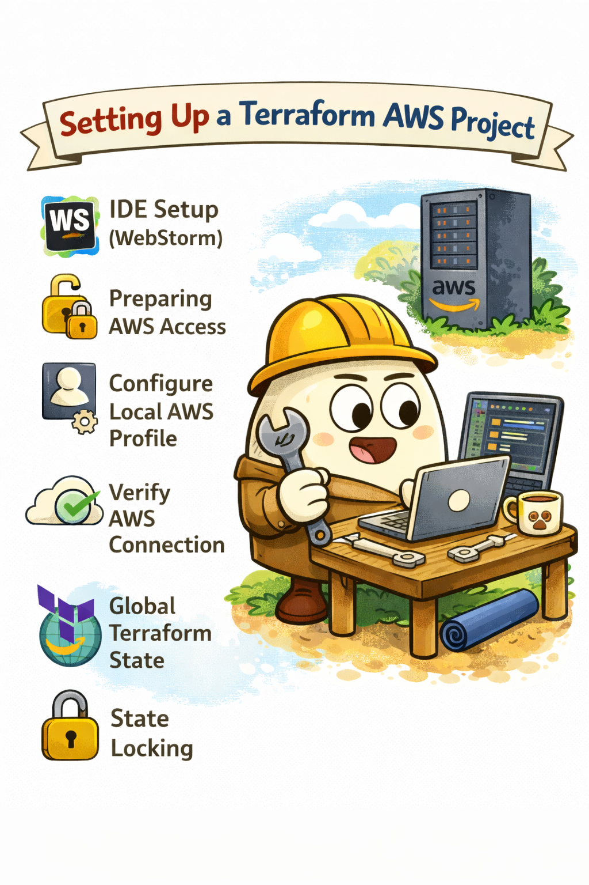

# Development Setup

<p align="center">
  
</p>

Before working with the Terraform infrastructure in this repository, several initial steps are required.

These steps ensure a consistent development environment and secure access to AWS resources.

---

## IDE Setup (WebStorm)

If you are using **WebStorm**, it is recommended to configure automatic formatting for Terraform files.

### Install Terraform plugin

Install the official **Terraform plugin** in WebStorm to enable syntax highlighting and validation.

Steps:

- Open **Settings**
- Navigate to **Plugins**
- Search for **Terraform**
- Install the plugin

### Configure Terraform formatting watcher

To automatically format Terraform files, configure a **File Watcher**.

Steps:

1. Go to  
   `Settings → Tools → File Watchers`

2. Create a new watcher

3. Configure it as follows:

- **Name:** `terraform fmt`
- **Program:** `terraform`
- **Arguments:** `fmt`
- **File type:** Terraform

This ensures that Terraform files are automatically formatted on save.

---

## Preparing AWS Access

Terraform is run with short-lived credentials from **IAM Identity Center (AWS SSO)**. No long-lived access keys are created, so there is nothing to leak or rotate.

Using SSO instead of a shared admin user:

1. **Security** - credentials expire after a few hours and MFA is enforced by the identity provider.
2. **Auditability** - every API call is attributed to a named person and permission set.
3. **Access control** - access is granted and revoked centrally, per account and per permission set.

### Setting up IAM Identity Center

Steps (once per AWS organization, in the management account):

1. Open **IAM Identity Center** in the AWS Console and enable it in `eu-central-1`.
2. Create a user (or connect an external identity provider) and require MFA.
3. Create a **permission set** (see below) and assign the user and the AWS account to it.

Do not attach `AdministratorAccess`. Create a permission set named `TerraformOperator` with a customer-managed policy that allows only the services this repository manages:

| Service | Why |
| --- | --- |
| `ec2:*`, `elasticloadbalancing:*` | VPC, subnets, NAT, security groups, endpoints, ALB, the monitoring host |
| `ecs:*`, `application-autoscaling:*`, `servicediscovery:*` | Cluster, service, task definitions, autoscaling, Cloud Map |
| `ecr:*` | Repository and lifecycle policy |
| `rds:*`, `elasticache:*` | PostgreSQL and Redis |
| `s3:*`, `cloudfront:*`, `wafv2:*`, `acm:*`, `route53:*` | Frontend buckets, distribution, WAF, certificates, DNS |
| `kms:*`, `secretsmanager:*` | Encryption keys and application secrets |
| `logs:*`, `cloudwatch:*`, `sns:*`, `budgets:*` | Log groups, alarms, notifications, budget |
| `ssm:*` | Monitoring host access (Session Manager) and AMI parameters |
| `iam:*Role*`, `iam:*RolePolicy*`, `iam:*Policy*`, `iam:*InstanceProfile*`, `iam:PassRole` limited to the ARNs below | Roles and policies created by the modules; deny `iam:*User*` and `iam:*AccessKey*` |
| `iam:*OpenIDConnectProvider*` on `oidc-provider/token.actions.githubusercontent.com` | GitHub OIDC provider |
| `iam:CreateServiceLinkedRole` with `iam:AWSServiceName` in `ecs.amazonaws.com`, `elasticloadbalancing.amazonaws.com`, `rds.amazonaws.com`, `elasticache.amazonaws.com`, `ecs.application-autoscaling.amazonaws.com` | Service-linked roles AWS creates on first use |
| `sts:GetCallerIdentity` | Account lookups |

IAM ARNs this repository creates (account `<account-id>`):

- roles: `role/<project>-*` (GitHub roles, VPC flow logs, e.g. `<project>-vpc-flow-logs-role`), `role/ecs-task-role`, `role/ecs-task-execution-role`, `role/ec2-ecr-role`, `role/<rds-identifier>-enhanced-monitoring`
- policies: `policy/<project>-*` (GitHub deploy policies), `policy/allow-rds-secret-access`, `policy/ec2-secrets-access`
- instance profile: `instance-profile/ec2-instance-profile`
- OIDC provider: `oidc-provider/token.actions.githubusercontent.com`

Several of these names are not project-prefixed yet; the Task 9 renames make the patterns uniform, after which only `<project>-*` remains.

Narrow `Resource` to the project prefix wherever the service supports it. The one-off bootstrap (state bucket) can use a separate, short-lived permission set.

### Configure Local AWS Profile

Configure the profile:

```bash
aws configure sso
```

```bash
SSO session name (Recommended): prod-forge
SSO start URL [None]: https://<your-directory>.awsapps.com/start
SSO region [None]: eu-central-1
SSO registration scopes [sso:account:access]:
```

Pick the account and the `TerraformOperator` permission set, then name the profile (for example `prod-forge`). Log in whenever the session expires and export the profile:

```bash
aws sso login --profile prod-forge
export AWS_PROFILE=prod-forge
```

You can verify the configuration:

```shell
aws sts get-caller-identity
```

> **If you must use an IAM user**
>
> Only when Identity Center is not available. Create a user with the same restricted policy (never `AdministratorAccess`), enable **MFA**, and do not store its access keys in `~/.aws/credentials`. Keep the keys only to call STS and work with the temporary credentials:
>
> ```shell
> aws sts get-session-token \
>   --serial-number arn:aws:iam::<account-id>:mfa/<user> \
>   --token-code <6-digit-code> \
>   --duration-seconds 3600
> ```
>
> Export the returned `AccessKeyId`, `SecretAccessKey` and `SessionToken` as `AWS_ACCESS_KEY_ID`, `AWS_SECRET_ACCESS_KEY` and `AWS_SESSION_TOKEN`. Rotate the user keys at least every 90 days and delete the user when it is no longer needed.

## Global Terraform State

In a team environment, Terraform state must not be stored locally.

If multiple engineers work on the infrastructure, local state can easily lead to inconsistencies and broken deployments.

Instead, Terraform state should be stored in a remote backend.

The most common solution in AWS environments is an S3 bucket for storing Terraform state.

This allows all team members to work with the same infrastructure state.

## State Locking

When multiple engineers work with Terraform, there is a risk that two people might run terraform apply at the same time.

This can corrupt the infrastructure state and cause unpredictable results.

To prevent this, Terraform supports state locking.

In AWS environments, this is typically implemented using:

- **S3** - for storing state
- **DynamoDB** - for state locking

State locking ensures that only one Terraform operation can run at a time.

## Bootstrap Infrastructure

Because the Terraform backend itself requires infrastructure (S3 bucket and DynamoDB table), it is common to create a
small bootstrap Terraform project.

This bootstrap configuration is responsible for:

- creating the S3 bucket for Terraform state
- creating the DynamoDB table for state locking
- preparing the initial infrastructure required for the main Terraform project

Once the bootstrap infrastructure is created, the main Terraform project can safely use the remote backend.
