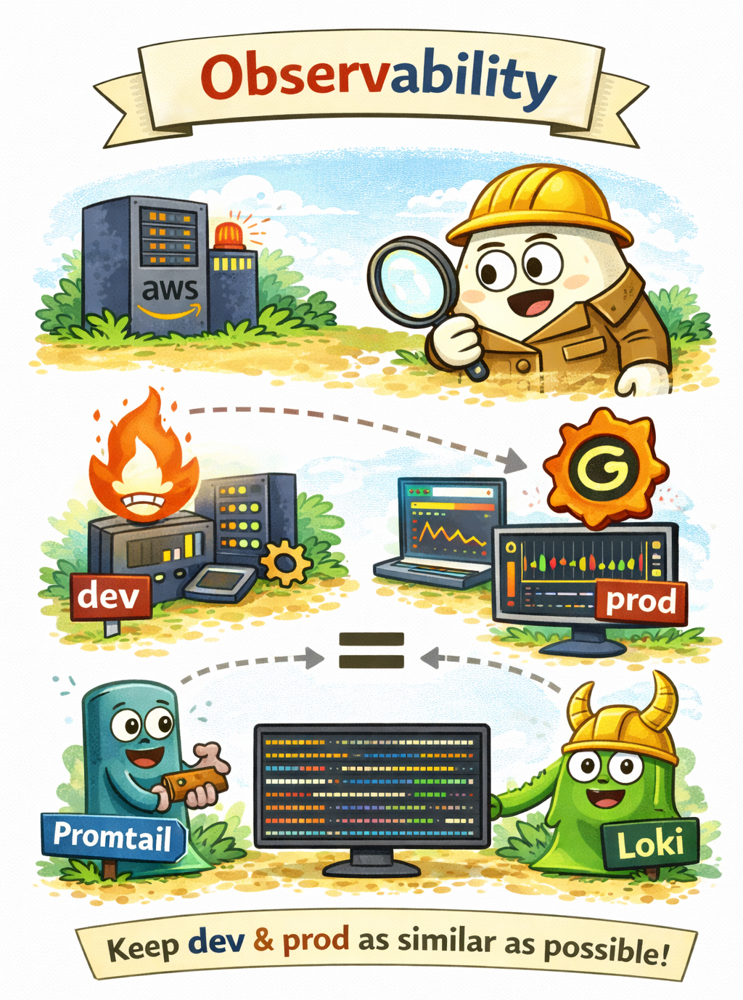

# Observability

<p align="center">
  
</p>

Observability is a critical component of any production infrastructure.
Without proper monitoring and logging, diagnosing issues in distributed systems becomes extremely difficult.

This project includes a basic observability stack designed to collect, store, and visualize both logs and metrics from
the running infrastructure.

The stack consists of the following components:

- Prometheus - metrics collection
- Grafana - visualization and dashboards
- Loki - log storage
- Promtail - log collector

## Deployment Model

In this project the observability stack is deployed on a dedicated EC2 instance.

The EC2 instance runs the monitoring services using Docker containers:

```text
EC2 Instance
 ├ Prometheus
 ├ Grafana
 ├ Loki
 └ Promtail
```

This instance continuously collects and stores telemetry data from the infrastructure and application services.

## Why EC2?

A dedicated EC2 instance is a practical solution for small and medium-sized systems.

Monitoring infrastructure must run 24/7 and remain independent from the application workload.
Using a dedicated instance ensures that monitoring services remain available even when application deployments occur.

Key responsibilities of the monitoring instance include:

- collecting application metrics
- storing system metrics
- aggregating logs
- providing dashboards and alerts

The observability stack in this project is designed to be:

- simple
- cost-effective
- easy to deploy
- sufficient for small and medium production systems

By running Prometheus, Grafana, Loki, and Promtail on a dedicated EC2 instance, the system gains essential monitoring
capabilities while keeping infrastructure complexity low.

## Observability Data Flow

The typical data flow in this stack looks like this:

```text
Application → stdout logs
       ↓
Promtail (log collector)
       ↓
Loki (log storage)
       ↓
Grafana (log visualization)
```

For metrics:

```text
Application → /metrics endpoint
       ↓
Prometheus (metrics scraping)
       ↓
Grafana (metrics dashboards)
```

This architecture follows common cloud-native observability patterns.

## Advantages of This Approach

### Simplicity

Running the observability stack on a single EC2 instance keeps the infrastructure simple and easy to maintain.

There is no need for complex distributed monitoring setups.

### Cost Efficiency

For small and medium systems, a single EC2 instance is significantly cheaper than fully managed monitoring platforms.

It allows teams to control resource usage and avoid vendor lock-in.

### Full Control

Hosting monitoring infrastructure internally provides full control over:

- log retention
- metrics storage
- dashboard configuration
- alerting rules

This can be important for projects with specific compliance or customization requirements.

### Infrastructure Independence

Monitoring should remain operational even if application services fail.

By separating observability services from the main application cluster, engineers can still access logs and metrics
during incidents.

## Limitations

While the EC2 approach works well for many projects, it also has several limitations.

### Single Point of Failure

A single monitoring instance can become a single point of failure.

If the EC2 instance stops or becomes unavailable, observability data may temporarily stop being collected.

For high availability setups, the monitoring stack should be deployed in a distributed configuration.

### Scaling Limitations

As the system grows, the amount of logs and metrics will increase.

A single instance may eventually become insufficient to handle:

- high log throughput
- large metrics datasets
- long retention periods

At that stage, the observability stack may need to be migrated to a more scalable architecture.

### Operational Maintenance

Self-hosted monitoring requires periodic maintenance, including:

- disk management
- upgrades
- backup strategies
- log retention policies

Managed services often remove this operational burden.

## When to Use Managed Observability

For larger systems, teams often migrate to managed solutions such as:

- AWS Managed Prometheus
- Grafana Cloud
- Datadog
- New Relic
- Elastic Observability

These platforms provide:

- automatic scaling
- high availability
- simplified maintenance

However, they usually come with higher operational costs.

## Alarms

The `alarms` module creates a KMS-encrypted SNS topic (`<project>-<environment>-alerts`) with an email subscription for `alert_email`, and the CloudWatch alarms below. Every alarm notifies the topic. The email subscription must be confirmed once from the link AWS sends. An empty `alert_email` creates the topic and alarms but no subscription and no budget.

| Area | Alarm | Condition |
| --- | --- | --- |
| ECS | CPU | average `CPUUtilization` > 80% for 5 minutes |
| ECS | Memory | average `MemoryUtilization` > 80% for 5 minutes |
| ALB | 5xx rate | target 5xx count / request count > 5% for 5 minutes (metric math) |
| ALB | Unhealthy targets | `UnHealthyHostCount` >= 1 |
| ALB | Latency | p95 `TargetResponseTime` > 0.5 s for 5 minutes |
| RDS | CPU | average `CPUUtilization` > 80% for 5 minutes |
| RDS | Free storage | `FreeStorageSpace` < 2 GB |
| RDS | Connections | `DatabaseConnections` > `rds_max_connections_alarm` |
| Redis | Engine CPU | `EngineCPUUtilization` > 80% for 5 minutes, one alarm per node |
| Redis | Evictions | `Evictions` > 0, one alarm per node |
| NAT | Port allocation | `ErrorPortAllocation` > 0, one alarm per NAT gateway |

Missing data is treated as not breaching, except for RDS free storage, where missing data breaches.

### Connection threshold

RDS PostgreSQL derives `max_connections` from instance memory (`LEAST(DBInstanceClassMemory/9531392, 5000)`), which is roughly 400 for `db.t4g.medium` (prod). CloudWatch has no `max_connections` metric, so the alarm uses an absolute threshold instead of a metric-math guess: `rds_max_connections_alarm`, default 320 (about 80%). Change it together with `rds_instance_class`.

### Budget

`aws_budgets_budget` tracks monthly cost against `monthly_budget_usd` and emails `alert_email` at 80% and 100% of actual spend. It is created only when both values are set. Prod sets `monthly_budget_usd = 400` and a placeholder `alert_email` in `prod.auto.tfvars`; replace the placeholder with the real mailbox before applying.

## Monitoring host access

The monitoring EC2 instance has no SSH key and port 22 is closed. It runs the latest Ubuntu 24.04 AMI (resolved from the public SSM parameter), IMDSv2 only, an encrypted 30 GB gp3 root volume and detailed monitoring. Use SSM Session Manager (see [debugging](debugging.md#monitoring-host-access-ssm-session-manager)).

- Grafana (3000) is open only to `admin_cidr_blocks`; an empty list (the default) opens nothing. Without a CIDR, reach it through SSM port forwarding.
- Prometheus (9090) is never exposed.
- The instance role has `AmazonSSMManagedInstanceCore`, read access to the backend secret, and optional read access to the observability config bucket and the Grafana admin secret (`observability_config_bucket_arn`, `grafana_admin_secret_arn` on the `monitoring/iam` module).
