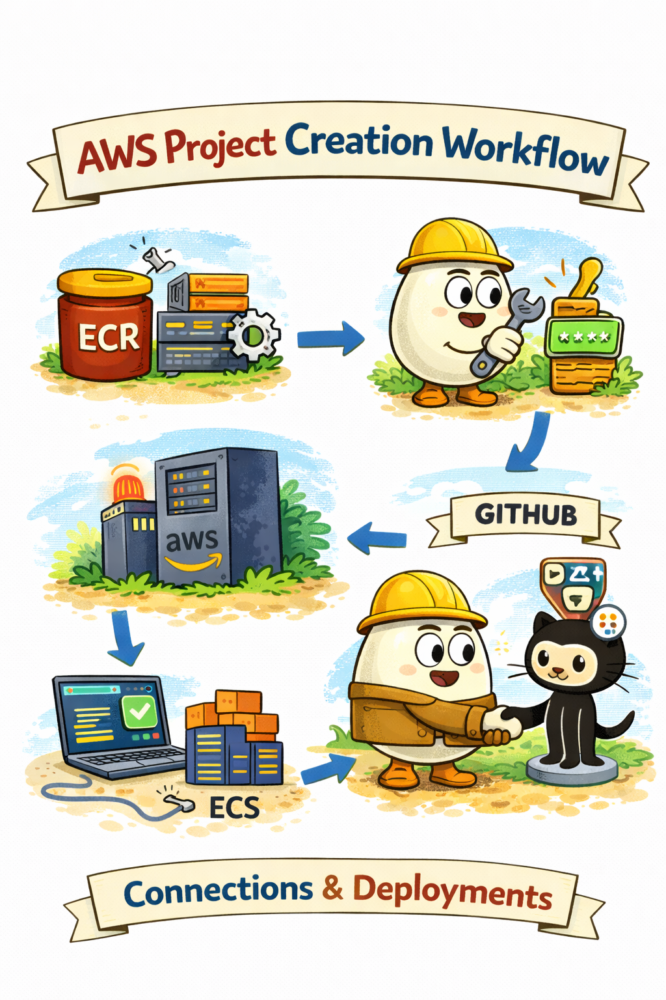
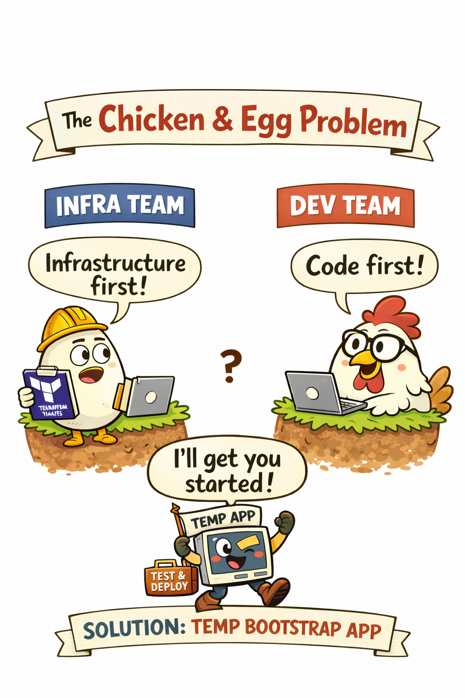

# Workflow

<p align="center">
  
</p>

After the above preparation, we can begin setting up the infrastructure.

It is recommended to create the infrastructure in stages:

- ECR
- Secrets Manager
- GitHub OIDC
- ECS Cluster
- ALB
- ECS Service
- Task Definition

Every command runs from the repository root against one environment root, `infrastructure/environments/dev` or `infrastructure/environments/prod` (see [Environments](environments.md)). Module addresses are under `module.stack`, which composes the modules for both environments.

## Amazon ECR

ECR will be used as the central registry for container images built by the CI/CD pipeline.

All application images will be pushed to this registry and later pulled by the runtime environment (for example ECS,
EKS, or other compute services).

You can initialize ECR first:

```shell
terraform -chdir=infrastructure/environments/<env> apply -target='module.stack.module.ecr.aws_ecr_repository.prod_forge_repo'
```

### The "Chicken-and-Egg" Dilemma

<p align="center">
  
</p>

In many organizations, the DevOps and backend teams work independently and often in parallel. This can create a common
problem during the early stages of a project:

How can infrastructure be configured if the backend service is not yet ready for deployment?

To reduce the dependency between these teams, we introduce a simple solution: a temporary bootstrap application.

### Initial Application Image

Inside the repository there is a folder called:

```shell
initial-image
```

This directory contains a minimal backend application used solely for bootstrapping the infrastructure.

The application should:

- use the same runtime as the real service
- be simple enough to build immediately
- be deployable to the infrastructure

For example, since the production backend uses Node.js, the bootstrap service uses Express as a minimal framework.

The goal of this service is not to implement business logic, but simply to provide a deployable container image that
allows infrastructure components to be tested.

We can build an initial image locally for initial work and upload it to ECR:

```shell
aws ecr get-login-password --region eu-central-1 \
| docker login \
--username AWS \
--password-stdin <USER_ID>.dkr.ecr.eu-central-1.amazonaws.com
```

```shell
docker buildx build \
--platform linux/amd64 \
-t <ECR_URL>:<version> \
--push .
```

#### Required Endpoints

The bootstrap service exposes a small set of endpoints.

- **/health** - This endpoint is required. When deploying services to AWS ECS, a health check must be configured. ECS
  periodically calls this endpoint to verify that the container is running correctly. The endpoint simply returns:

```shell
200 OK
```

This indicates that the service is alive and healthy.

- **/version** - This endpoint is optional but highly recommended. It returns the version of the currently running
  container. This makes it easy to:

    - verify which version is deployed
    - confirm that a deployment succeeded
    - detect situations where old containers are still running during rolling updates

## AWS Secrets Manager

Sensitive configuration values such as:

- API keys
- database credentials
- third-party service tokens
- application secrets

should never be stored in the repository or Terraform variables.

Instead, they should be stored in **AWS Secrets Manager**, which provides secure storage, access control, and auditing.

If any secrets are already known at this stage of the project, they can be added to **Secrets Manager immediately** so
that they are available for the infrastructure and application during deployment.

```shell
terraform -chdir=infrastructure/environments/<env> apply -target='module.stack.module.secrets_manager.aws_secretsmanager_secret.prod_forge_secret'
```

The secret is named by `app_secret_name`: `prod_forge/backend/config-v1` in prod and `prod_forge/backend/dev/config-v1` in dev (names are unique per account). The examples use the prod name.

The task definition reads one key from this secret: `SENTRY_DSN`, and only when `backend_config.sentry_enabled = true` (the backend sends events only when `SENTRY_ENABLED=true` and a DSN is set). The database password, Redis AUTH token and JWT secret are not stored here; they come from the RDS-managed secret and the generated secrets below. Store the value before enabling Sentry, otherwise new tasks fail to start:

```shell
aws secretsmanager put-secret-value \
  --secret-id prod_forge/backend/config-v1 \
  --secret-string '{"SENTRY_DSN":"https://<public-key>@<org>.ingest.sentry.io/<project-id>"}'
```

Retrieve a secret value:

```shell
aws secretsmanager get-secret-value \
  --secret-id prod_forge/backend/config-v1 \
  --query SecretString \
  --output text
```

```shell
aws secretsmanager get-secret-value \
  --secret-id prod_forge/backend/config-v1 \
  --query SecretString \
  --output text | jq -r '.SENTRY_DSN'
```

### Generated secrets

Terraform generates these secrets with `random_password` (64 characters, no special characters so they are safe in env vars and in the ElastiCache AUTH token) and stores them encrypted with the same KMS key:

- `<project>/<environment>/redis-auth` - the Redis AUTH token, injected into the task as `REDIS_PASSWORD`.
- `<project>/<environment>/jwt-secret` - the JWT signing secret, injected as `JWT_SECRET`. The backend refuses to start without it (at least 32 characters).
- `<project>/<environment>/grafana-admin` - the Grafana admin password, read by the monitoring host (32 characters).

The task execution role may read the first two. Every secret has `recovery_window_in_days = secret_recovery_window_days`: 30 in prod, 0 in dev so a destroyed dev can be recreated with the same names right away. Values live in Terraform state, so keep the state bucket private and encrypted.

## GitHub Integration for CI/CD

Once Secrets Manager and ECR are configured, the next step is to connect the GitHub repository to the CI/CD pipeline.

This allows the pipeline to:

- build Docker images
- push images to ECR
- trigger deployment processes automatically

### Approaches

There are two main ways to grant the CI/CD pipeline access to AWS:

#### 1. Dedicated AWS User

Create a dedicated IAM user specifically for CI/CD tasks.

Then configure:

- ACCESS_KEY_ID
- SECRET_ACCESS_KEY

as GitHub Secrets in the repository settings.

All actions in the CI/CD pipeline will run under this user’s permissions.

This approach works but requires careful management of IAM keys. Rotating secrets and enforcing least-privilege
policies can be cumbersome.

#### 2. OpenID Connect (OIDC) - Recommended

A more secure and modern approach is to configure OIDC between GitHub and AWS.

- The repository itself is trusted to assume roles in AWS
- No IAM user or long-lived keys are needed
- Permissions are granted per repository, making the workflow cleaner and safer

With this setup, the GitHub Actions workflow can assume a role that has privileges such as pushing images to ECR and
deploying infrastructure.

### Terraform Setup

To create the OIDC provider via Terraform, run:

```shell
terraform -chdir=infrastructure/environments/<env> apply -target=module.stack.module.github_oidc
```

The OIDC provider is account-wide: only one may exist per account. Prod creates it (`create_github_oidc_provider = true`); dev in the same account sets `false` and reads it with a data source, so apply prod first.

This step ensures that:

- GitHub Actions can authenticate to AWS securely
- Only authorized workflows can perform deployments
- The CI/CD workflow is fully automated and auditable

### Roles and trust conditions

The `github-oidc` module creates one role per repository, so a compromised repository cannot use the other one's permissions:

| Role | Trusted subjects (`sub`) | Permissions |
| --- | --- | --- |
| `<project>-<environment>-github-backend-role` | `repo:prod-forge/backend:environment:<environment>` | ECR push to the application repository, ECS deploy, migration task, rollback |
| `<project>-<environment>-github-frontend-role` | `repo:prod-forge/frontend:environment:<environment>` | S3 sync on the web client and assets buckets, CloudFront invalidation |

Both roles also require `aud = sts.amazonaws.com`. The subject is matched exactly (`StringEquals`), with no wildcard.

Only the `environment:<environment>` subject is trusted (`environment:prod` for the prod roles, `environment:dev` for the dev roles), so deploy jobs must declare that GitHub environment. The environment's protection rules (required reviewers, branch and tag restrictions) are then enforced before AWS hands out credentials. A ref-based subject such as `ref:refs/tags/v*` is deliberately not trusted: any workflow run on a tag without an environment would otherwise bypass those rules.

### Rollout notes

- **Role names change.** The workflows take the role from the `AWS_DEPLOY_ROLE_ARN` repository variable (see [Deploy workflow variables](#deploy-workflow-variables)): set it to `github_backend_role_arn` in the backend repository and to `github_frontend_role_arn` in the frontend repository. A stale value (the old `github-actions-ecs-ecr-role`) fails with `Not authorized to perform sts:AssumeRoleWithWebIdentity`.
- **ECR tags are immutable.** The backend `cd.yml` pushes only the version tag (`<version>` from the `v*` tag), so a normal release works. Re-running a release for the same tag, or pushing `latest`, is rejected; cut a new tag instead.
- **ECR is replaced; migrate the images by hand first.** Enabling KMS encryption and the per-environment name (`<project>` becomes `<project>-<environment>`) force a new repository, and `terraform apply` cannot delete a non-empty repository (`RepositoryNotEmptyException`), so the apply would stop half-way. Before applying:
  1. List the images: `aws ecr describe-images --repository-name <project> --query 'imageDetails[].imageTags'`.
  2. Note the tags you still need (the running release and the rollback targets). Pull and keep them locally if they cannot be rebuilt.
  3. Delete the images: `aws ecr batch-delete-image --repository-name <project> --image-ids "$(aws ecr list-images --repository-name <project> --query 'imageIds[]' --output json)"`. `batch-delete-image` accepts at most 100 image ids per call, so for a larger repository delete in batches (loop over `list-images --max-items 100`), or delete the whole repository instead: `aws ecr delete-repository --repository-name <project> --force`.
  4. Run `terraform apply`, then push the current release tag (and the `initial` image, see above) to the new repository (output `ecr_repository_url`) before ECS starts new tasks, because running tasks cannot pull from the missing repository.
- **Old IAM resources are replaced.** The `github-actions-ecs-ecr-role` role and the `github-actions-*` policies are removed and recreated under the new names.

### Deploy workflow variables

The backend and frontend workflows hard-code no AWS names: every name and network id comes from a GitHub variable of the `prod` environment (or the repository), filled from `terraform output` of the environment root. Re-run the commands after an apply that changes a name.

Backend repository (`cd.yml`, `rollback.yml`, `show-ecs-revisions.yml`):

| Variable | Terraform output | prod value |
| --- | --- | --- |
| `AWS_DEPLOY_ROLE_ARN` | `github_backend_role_arn` | `arn:aws:iam::<account>:role/prod-forge-todolist-prod-github-backend-role` |
| `ECR_REPOSITORY` | `ecr_repository_name` | `prod-forge-todolist-prod` |
| `ECS_CLUSTER` | `ecs_cluster_name` | `prod-forge-todolist-prod-cluster` |
| `ECS_SERVICE` | `ecs_service_name` | `prod-forge-todolist-prod-service` |
| `ECS_TASK_FAMILY` | `ecs_task_definition_family` | `prod-forge-todolist-prod-task` |
| `ECS_MIGRATION_TASK_FAMILY` | `ecs_migration_task_definition_family` | `prod-forge-todolist-prod-migration-task` |
| `ECS_MIGRATION_LOG_GROUP` | `ecs_migration_log_group_name` | `/ecs/prod-forge-todolist-prod-task-migration` |
| `PRIVATE_SUBNET_IDS` | `private_subnet_ids` (comma-joined) | `subnet-0aaa,subnet-0bbb,subnet-0ccc` |
| `ECS_SECURITY_GROUP_ID` | `ecs_security_group_id` | `sg-0123456789abcdef0` |

Frontend repository (`cd.yml`, `rollback.yml`, `show-web-client-versions.yml`):

| Variable | Terraform output | prod value |
| --- | --- | --- |
| `AWS_DEPLOY_ROLE_ARN` | `github_frontend_role_arn` | `arn:aws:iam::<account>:role/prod-forge-todolist-prod-github-frontend-role` |
| `S3_WEB_CLIENT_BUCKET` | `web_client_bucket_name` | `prod-forge-todolist-prod-web-client` |
| `S3_ASSETS_BUCKET` | `assets_bucket_name` | `prod-forge-todolist-prod-assets` |
| `CLOUDFRONT_DISTRIBUTION_ID` | `cloudfront_distribution_id` | `E1ABCDEFGHIJKL` |
| `CLOUDFRONT_URL` | `cloudfront_url` | `https://<domain_name>` or `https://<id>.cloudfront.net` |
| `VITE_API_BASE_URL` | `api_url` + `/api/v1/` | `https://api.<domain_name>/api/v1/` |

With the GitHub CLI, from the repository root of this project (`<repo>` is `prod-forge/backend` or `prod-forge/frontend`):

```shell
out() { terraform -chdir=infrastructure/environments/prod output -raw "$1"; }

gh variable set AWS_DEPLOY_ROLE_ARN --env prod --repo prod-forge/backend --body "$(out github_backend_role_arn)"
gh variable set ECS_CLUSTER --env prod --repo prod-forge/backend --body "$(out ecs_cluster_name)"
gh variable set PRIVATE_SUBNET_IDS --env prod --repo prod-forge/backend \
  --body "$(terraform -chdir=infrastructure/environments/prod output -json private_subnet_ids | jq -r 'join(",")')"
```

The migration task runs with `assignPublicIp=DISABLED` in `PRIVATE_SUBNET_IDS` and `ECS_SECURITY_GROUP_ID`, the same network as the service; it reaches ECR, Secrets Manager and CloudWatch Logs through the NAT gateways or the VPC endpoints. The deploy role may run only the `ECS_MIGRATION_TASK_FAMILY` family, so a different family fails with `AccessDeniedException` on `ecs:RunTask`.

### Why OIDC is Recommended

- No hard-coded credentials in GitHub secrets
- Least privilege - only the repository can assume the role
- Improved security - reduces risk of compromised keys
- Cleaner workflow - easier to manage and audit access

## ECS Cluster

After applying the Terraform configuration, a new ECS Cluster should appear in the AWS Console.

You can verify this by navigating to:

```shell
AWS Console → ECS → Clusters
```

The cluster will be used to run our backend services using AWS Fargate.

- **Container Insights** runs in `enhanced` mode, so per-task CPU, memory, network and restart metrics show up in CloudWatch → Container Insights.
- **Capacity providers.** `FARGATE` and `FARGATE_SPOT` are registered, and the default strategy is 100% `FARGATE`. See [Scaling](scaling.md#fargate-spot-trade-off) for when Spot makes sense.

### Networking

ECS tasks run in private subnets and get no public IP. Outbound traffic leaves through NAT gateways (one per AZ in prod, one shared NAT gateway by default) via a private route table per AZ with `0.0.0.0/0` → NAT.

- **VPC endpoints.** An S3 gateway endpoint is always on (ECR image layers live in S3). With `vpc_enable_endpoints = true` (prod), interface endpoints for `ecr.api`, `ecr.dkr`, `secretsmanager`, `logs` and `ssmmessages` keep image pulls, secret reads, log delivery and ECS Exec inside the VPC instead of going through NAT.
- **Security group.** The ECS group allows ingress only on port 3000 from the ALB group. Egress is limited to HTTPS (443, for AWS APIs and external services such as Sentry), PostgreSQL 5432 to the RDS group and Redis 6379 to the Redis group.
- **Flow logs.** VPC flow logs (all traffic) go to the `/vpc/<project>-<environment>-flow-logs` log group with 30 days of retention.

Without the NAT route or the endpoints, tasks in private subnets cannot pull images from ECR or read secrets from Secrets Manager, and the deployment fails with `CannotPullContainerError` or `ResourceInitializationError`.

## Application Load Balancer (ALB)

Once the Application Load Balancer is created, you can verify it using the AWS CLI:

```shell
aws elbv2 describe-load-balancers --region eu-central-1
```

The output should contain a DNS name for the load balancer.

Example:

```shell
DNSName: xyz123.eu-central-1.elb.amazonaws.com
```

At this stage, if you open the DNS address in your browser, the response will likely be:

```shell
503 Service Unavailable
```

This is expected because the ECS service may not yet have a healthy running task attached to the load balancer.

When `domain_name` is set, the ALB serves `api.<domain>` on 443 with an ACM certificate and port 80 only returns `301` to HTTPS. Without a domain it stays on plain HTTP; see [Security](security.md#without-a-domain-insecure-fallback). The ALB drops invalid header fields, writes access logs to the access-logs bucket and has deletion protection in prod. A regional WAF ACL is associated with it.

## ECS Service

The ECS service is responsible for running and maintaining the desired number of application tasks.

You can inspect the service using the following commands.

List services in the cluster:

```shell
aws ecs list-services \
  --cluster <CLUSTER_NAME> \
  --region eu-central-1
```

Describe the service in detail:

```shell
aws ecs describe-services \
  --cluster <CLUSTER_NAME> \
  --services <SERVICE_NAME> \
  --region eu-central-1
```

This will show information such as:

- running tasks
- desired task count
- deployment status
- load balancer configuration

Service behavior:

- **Auto scaling.** Application Auto Scaling keeps between `min_capacity` and `max_capacity` tasks (prod: 2 to 10) with target tracking on CPU (60%) and on ALB requests per target (1000). Terraform ignores `desired_count` after creation. Details and load test steps are in [Scaling](scaling.md).
- **Deployment circuit breaker** with automatic rollback: a deployment whose tasks keep failing is rolled back to the previous task definition.
- **Health check grace period** of 60 seconds before ALB health checks can mark a new task unhealthy.
- **Tags** from the service are propagated to its tasks (`propagate_tags = "SERVICE"`).
- **Service discovery** (`service_discovery_arn`) is off until a Cloud Map namespace exists.

### IAM

- The **task execution role** (used by the ECS agent) has `AmazonECSTaskExecutionRolePolicy` plus read access to the RDS, Redis AUTH and JWT secrets and the app config secret (`app_secret_name`, `SENTRY_DSN`), and `kms:Decrypt` on the project key.
- The **task role** (used by the application) only allows the `ssmmessages` channel actions needed by ECS Exec.
- The **GitHub Actions** (backend role) deploy policy is scoped to the cluster, the service, the application and migration task definition families and the cluster's tasks. Only the task definition actions that do not support resource-level permissions (`Register`, `Deregister`, `Describe`, `ListTaskDefinitions`) use `*`. `iam:PassRole` is limited to the ARNs of this environment's task and execution roles and to `ecs-tasks.amazonaws.com` (`iam:PassedToService`).

## Task Definition

A Task Definition describes how our backend application should run inside ECS.

When using AWS Fargate, we define the compute resources allocated to the container.

Task size is set by the `cpu` and `memory` module variables: 256 / 512 MiB by default, 512 / 1024 MiB in prod.

This defines the virtual machine resources that will be allocated to the containerized service.

Container settings worth knowing:

- `NODE_ENV=production` is set in the environment. The reported app version comes from the image's `package.json`, not from the task definition, because CD only swaps the image when it registers a new revision. TLS certificate verification is never disabled.
- The image contains no `.env` files, so the task definition sets every variable the backend validates (see [Backend configuration](#backend-configuration)).
- `stopTimeout = 60`: the backend drains for 10 s and waits up to 20 s for in-flight requests on SIGTERM, so 60 s leaves headroom before SIGKILL. Keep it above the sum of the backend timeouts.
- `linuxParameters.initProcessEnabled = true`: runs an init process as PID 1, which ECS Exec needs and which reaps zombie processes.
- `readonlyRootFilesystem = false`: NestJS and Prisma write to the container filesystem at runtime.
- Logs go to the `/ecs/<project>-<environment>` log group in the configured region; retention is `log_retention_days` (7 by default, 30 in prod).

The task definition also specifies the Docker image that will be deployed.

### Backend configuration

The backend validates its configuration at startup (`src/config/*.config.ts` in the backend repository) and runs on the defaults of any variable that is not set. The task definition sets all of them except `APP_NAME`, `APP_DESCRIPTION` and `APP_VERSION`, which come from the image's `package.json`. The migration task is not managed here: at release time backend CD renders `ecs/migration-task.json` with `scripts/render-migration-task.sh`, which copies the roles, `environment` and `secrets` of the latest application task definition revision with `jq` (JSON-valued entries such as `API_ALLOWED_ORIGINS` keep their escaping). It has the same variables as the application only when this stack was applied before the release; a release against an older revision copies that older set.

Fixed by the infrastructure (module constants):

| Variable | Value | Why |
| --- | --- | --- |
| `NODE_ENV` | `production` | |
| `APP_HOST`, `APP_PORT` | `0.0.0.0`, `3000` | container port, target group and Prometheus scrape port |
| `API_PREFIX` | `api` | the web and mobile clients call `/api/v1` |
| `API_ALLOWED_ORIGINS` | `["https://<domain_name>", "https://<cloudfront domain>"]` | CORS for the web client; the custom domain only when `domain_name` is set |
| `TRUST_PROXY` | `1` | one hop (the ALB), so throttling and logs use the client address |
| `DATABASE_HOST`, `DATABASE_PORT`, `DATABASE_NAME`, `DATABASE_USER` | RDS outputs | |
| `DATABASE_SSL` | `true` | RDS enforces TLS; the backend image trusts the RDS CA bundle (`NODE_EXTRA_CA_CERTS`) |
| `REDIS_ENABLED`, `REDIS_HOST`, `REDIS_PORT`, `REDIS_TLS` | `true`, replication group endpoint, `6379`, `true` | |
| `LOG_PRETTY` | `false` | JSON lines for CloudWatch Logs |
| `SWAGGER_ENABLED` | `false` | the backend never serves API docs with `NODE_ENV=production` |

Tunables, set per environment in `backend_config` (`terraform.tfvars`); an omitted attribute uses the backend default:

| `backend_config` attribute | Variable | Default | prod | dev |
| --- | --- | --- | --- | --- |
| `log_level` | `LOG_LEVEL` | `info` | `info` | `trace` |
| `log_exclude_endpoints` | `LOG_EXCLUDE_ENDPOINTS` | `[]` | default | default |
| `database_log_levels` | `DATABASE_LOG_LEVELS` | `[]` | `["warn","error"]` | `["warn","error"]` |
| `database_pool_max` | `DATABASE_POOL_MAX` | `10` | `10` | `5` |
| `database_connect_timeout_ms` | `DATABASE_CONNECT_TIMEOUT_MS` | `5000` | default | default |
| `database_statement_timeout_ms` | `DATABASE_STATEMENT_TIMEOUT_MS` | `5000` | default | default |
| `database_fail_fast` | `DATABASE_FAIL_FAST` | `true` | default | default |
| `jwt_ttl` | `JWT_TTL` (seconds) | `3600` | `3600` | `3600` |
| `throttle_enabled` | `THROTTLE_ENABLED` | `true` | `true` | `true` |
| `throttle_limit` | `THROTTLE_LIMIT` | `60` | `60` | `60` |
| `throttle_ttl` | `THROTTLE_TTL` (ms) | `60000` | `60000` | `60000` |
| `shutdown_drain_ms` | `SHUTDOWN_DRAIN_MS` | `10000` | `10000` | `10000` |
| `shutdown_inflight_timeout_ms` | `SHUTDOWN_INFLIGHT_TIMEOUT_MS` | `20000` | `20000` | `20000` |
| `health_check_trigger_ms` | `HEALTH_CHECK_TRIGGER_MS` | `15000` | default | default |
| `api_allowed_non_browser_origins` | `API_ALLOWED_NON_BROWSER_ORIGINS` | `true` | default | default |
| `sentry_enabled` | `SENTRY_ENABLED` (and the `SENTRY_DSN` secret) | `false` | `false` | `false` |
| `sentry_ignored_errors` | `SENTRY_IGNORED_ERRORS` | `[]` | default | default |
| `otel_exporter_otlp_endpoint` | `OTEL_EXPORTER_OTLP_ENDPOINT` (omitted when empty) | `""` | default | default |

The two shutdown values must stay below the 60 s `stopTimeout` (validated). Secrets (`secrets`, never `environment`): `DATABASE_PASSWORD` from the RDS-managed master secret (`password` key), `REDIS_PASSWORD` from `redis-auth`, `JWT_SECRET` from `jwt-secret`, and `SENTRY_DSN` from the app config secret when Sentry is enabled.

A changed environment takes effect with the next backend release: the ECS service ignores `task_definition` (CD owns it), and CD registers each release from the latest revision of the family, so it carries the new environment with the new image.

You can see logs from the container:

```shell
aws logs describe-log-groups
```

Find your log group (for example, */ecs/prod-forge-todolist-prod*):

```shell
aws logs tail <LOG_GROUP> --since 10h
```

## Redis

Redis runs as an `aws_elasticache_replication_group`. Prod has two nodes (primary plus replica), Multi-AZ and automatic failover; dev runs one node (`redis_num_cache_clusters = 1`), which turns Multi-AZ and failover off. A single `aws_elasticache_cluster` node has no failover: a node or AZ failure means downtime. A replication group promotes the replica automatically and exposes a stable primary endpoint, which the backend uses as `REDIS_HOST`.

- **Encryption.** At-rest encryption uses the project KMS key. In-transit encryption (TLS) is on, so the backend sets `REDIS_TLS=true`. TLS costs some CPU and a little latency for the handshake and per-message encryption; on `cache.t4g.*` nodes this is negligible for a cache of this size.
- **AUTH.** The token comes from the `redis-auth` secret and reaches the container as `REDIS_PASSWORD`. AUTH requires transit encryption.
- **Snapshots.** Daily snapshots (7 days of retention in prod, 1 by default). Maintenance and snapshot windows do not overlap.
- **Sizing.** Prod uses `cache.t4g.small`, the module default is `cache.t4g.micro`.
- **Rotating the AUTH token.** Change the `random_password` (for example `terraform -chdir=infrastructure/environments/prod apply -replace=module.stack.module.secrets_manager.random_password.redis`) and apply. ElastiCache applies the new token in place, but running tasks still hold the old value, so force a new ECS deployment right after the apply to pick up the new secret.
- **Migration note.** Replacing the old `aws_elasticache_cluster` with a replication group recreates Redis. Cached data is lost, which is acceptable for a cache; expect a short window with no Redis during the apply.

## One-Run ECS Tasks

Certain operations should not run as permanent services.

Examples include:

- database migrations
- seed scripts
- maintenance jobs

For these cases we use one-run ECS tasks.

Inside the backend repository there is a directory:

```markdown
ecs/
```

This directory contains a task template used to run migration jobs.

These tasks are not created at the infrastructure level because they are ephemeral by nature.

Instead they are:

1. created during the release pipeline
2. executed once
3. removed after completion

This approach keeps infrastructure clean while still allowing safe execution of operational tasks.

Typical workflow:

```markdown
CI/CD → run migration task → apply schema changes → deploy new application version
```

Because database migrations follow a forward-only strategy, running them before application deployment is safe.

The migration task runs in the same private subnets and security group as the service, so it needs no public IP: backend `cd.yml` starts it with `assignPublicIp=DISABLED` in `PRIVATE_SUBNET_IDS` and `ECS_SECURITY_GROUP_ID` (see [Deploy workflow variables](#deploy-workflow-variables)).
