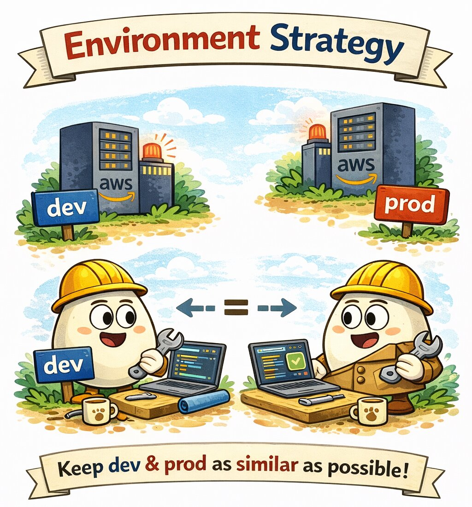

# Environments

<p align="center">
  
</p>

Many projects introduce multiple environments such as:

- development
- staging
- pre-production
- production

While this may seem beneficial, in practice maintaining too many environments often increases operational complexity.

Each additional environment introduces:

- configuration drift
- infrastructure overhead
- additional maintenance
- inconsistent behavior between environments

Because of this, the approach used in this project is intentionally simple.

## Environment Strategy

The system operates with two primary environments:

- dev
- prod

The key principle is that these environments should be as similar as possible.

Infrastructure, configuration patterns, and deployment processes should mirror each other closely. This reduces the risk
of unexpected issues appearing only after deployment to production.

### Development Environment (dev)

The dev environment is used for:

- active development
- experimentation and prototyping
- integration testing
- validating infrastructure changes

Developers can safely iterate and test new functionality here without affecting live users.

### Production Environment (prod)

The prod environment represents the live system.

It serves real users and therefore must prioritize:

- stability
- reliability
- observability
- safe deployment practices

All production deployments are executed through the automated CI/CD pipeline.

### Why Not Use Pre-Production?

Some teams introduce an additional pre-production or staging environment before production.

The goal is usually to perform a final verification before deploying to production.

However, this approach can sometimes create a false sense of safety and increase operational overhead.

Instead, this project follows a different philosophy:

> Production deployments should be frequent, small, and predictable.

When releases happen regularly and the deployment process is fully automated, deploying to production becomes a routine
operation rather than a risky event.

Smaller and more frequent releases reduce risk and allow issues to be detected and resolved faster.

## Key Principle

The most important rule is:

**Environments should behave the same way.**

If development and production environments are consistent in terms of infrastructure and configuration, the likelihood
of unexpected production issues is significantly reduced.

## Layout in the Code

Both environments are built from the same code. Only the variable values differ.

```text
infrastructure/
  modules/
    stack/              # composes every module below; one call per environment
    vpc/ rds/ redis/ ecs-service/ ...
  environments/
    prod/               # backend, providers, terraform.tfvars, moved.tf, tests/
    dev/                # backend, providers, terraform.tfvars
  observability/        # stack configuration uploaded to S3 by both environments
```

- `infrastructure/modules/stack` holds the composition that used to be the `infrastructure/` root. It takes typed inputs for everything that differs between environments.
- `infrastructure/environments/<env>` is a tiny root: the S3 backend, the two AWS providers (regional and `us-east-1`) with `default_tags`, the `module "stack"` call and `terraform.tfvars`.
- Every resource name is `<project>-<environment>-<name>` (for example `prod-forge-todolist-dev-cluster`), so both environments can live in one AWS account without name collisions. The Cloud Map namespace is a DNS name instead: `service_namespace` is `<project>.local` in prod and `<project>-dev.local` in dev.
- Every resource gets the tags `Project`, `Environment`, `Owner`, `CostCenter`, `ManagedBy = "terraform"` and `Repository` from the provider `default_tags`; modules set only a `Name` tag where AWS shows it.

Commands run from the repository root with `-chdir`:

```shell
terraform -chdir=infrastructure/environments/dev init
terraform -chdir=infrastructure/environments/dev plan
terraform -chdir=infrastructure/environments/dev apply
```

### Differences Between dev and prod

| Setting | dev | prod |
| --- | --- | --- |
| NAT gateways (`vpc_nat_per_az`) | 1 shared | 1 per AZ |
| Interface VPC endpoints (`vpc_enable_endpoints`) | off | on |
| RDS class / Multi-AZ | `db.t4g.micro`, single AZ | `db.t4g.medium`, Multi-AZ |
| RDS backups / deletion protection | 1 day, off | 7 days, on |
| Redis | 1 `cache.t4g.micro` node, no failover | 2 `cache.t4g.small` nodes, Multi-AZ failover |
| ECS tasks (desired / min / max) | 1 / 1 / 2, 256 CPU / 512 MiB | 2 / 2 / 10, 512 CPU / 1024 MiB |
| ALB deletion protection | off | on |
| WAF (`enable_waf`) | off | on (ALB and CloudFront) |
| Client VPN (`enable_client_vpn`) | off (use SSM) | on |
| Log retention (ECS) | 7 days | 30 days |
| Secret recovery window | 0 days (immediate delete) | 30 days |
| GitHub OIDC provider | read (`create_github_oidc_provider = false`) | created |
| CloudTrail, GuardDuty, Access Analyzer | covered by prod | created |
| GitHub environment trusted by the deploy roles | `dev` | `prod` |
| Monthly budget (whole account, see [Cost](cost.md#budget)) | none (`0`) | 800 USD |
| Cloud Map namespace (`service_namespace`) | `<project>-dev.local` | `<project>.local` |
| State key | `environments/dev/terraform.tfstate` | `infrastructure/terraform.tfstate` |

### One AWS Account or Two

The defaults assume dev and prod share one account. Some things exist only once per account, so prod owns them and dev reads or skips them:

- the GitHub OIDC provider (`create_github_oidc_provider`);
- the account-wide cost budget (`monthly_budget_usd`, see [Cost](cost.md#budget));
- the CloudTrail trail, the GuardDuty detector and the IAM Access Analyzer (`enable_account_security_services`, see [Security](security.md#account-security-baseline)).

With a separate dev account, run the bootstrap there too, point the dev backend at that bucket and set those switches to `true` in `environments/dev/terraform.tfvars`.

## Creating dev

1. Apply prod first (or, in a separate account, run the bootstrap there). Dev reads the GitHub OIDC provider created by prod.
2. Create the `dev` GitHub environment in the backend and frontend repositories when dev CD workflows exist (step 7); the dev roles trust only `environment:dev`.
3. Review `infrastructure/environments/dev/terraform.tfvars` (alert email, budget, admin CIDRs).
4. Create the infrastructure in stages, as in [Workflow](workflow.md): ECR and the application secret first, then the rest.

   ```shell
   terraform -chdir=infrastructure/environments/dev init
   terraform -chdir=infrastructure/environments/dev apply -target=module.stack.module.ecr -target=module.stack.module.secrets_manager
   ```

5. Push the initial image to the dev repository (`terraform -chdir=infrastructure/environments/dev output ecr_repository_url`) and fill `prod_forge/backend/dev/config-v1`.
6. Apply the whole environment:

   ```shell
   terraform -chdir=infrastructure/environments/dev apply
   ```

7. Deploy to dev by hand for now. CD deploys prod only: every backend and frontend deploy workflow runs in the `prod` GitHub environment, and there are no dev workflows yet. Terraform already creates the dev deploy roles (`<project>-dev-github-backend-role` / `<project>-dev-github-frontend-role`, trusting only `environment:dev`) for when they exist; the gap is tracked in `docs/open-issues/dev-cd-workflows.md`.

Dev is meant to be disposable: RDS and the ALB have no deletion protection and secrets are deleted without a recovery window, so `terraform destroy` followed by `apply` recreates it under the same names. The RDS final snapshot `<project>-dev-final` must be deleted before a second destroy, because snapshot names are unique.

## Cost per Environment

Approximate monthly cost in `eu-central-1` at list prices, before data transfer and request charges. Details and the main levers are in [Cost](cost.md).

| Environment | Estimate (USD / month) | Biggest items |
| --- | --- | --- |
| dev | about 150 | single NAT gateway, ALB, monitoring host, small RDS and Redis, public IPv4 |
| prod | about 580 | Multi-AZ RDS, two NAT gateways, five interface endpoints in two AZs, Client VPN, Redis pair, WAF |
